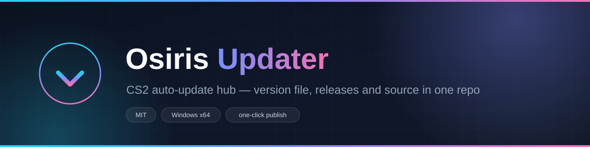
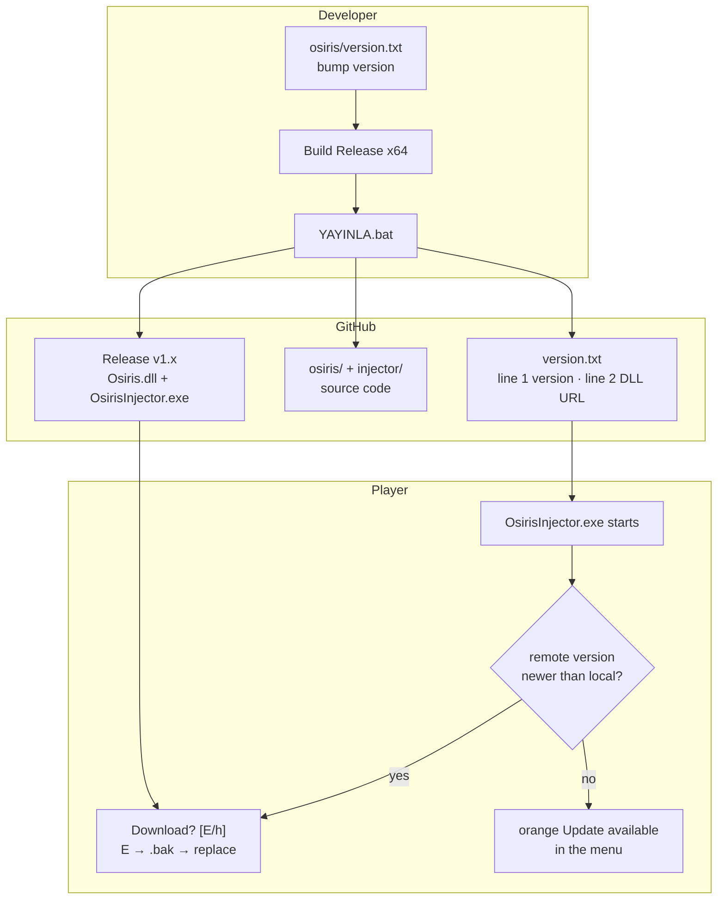
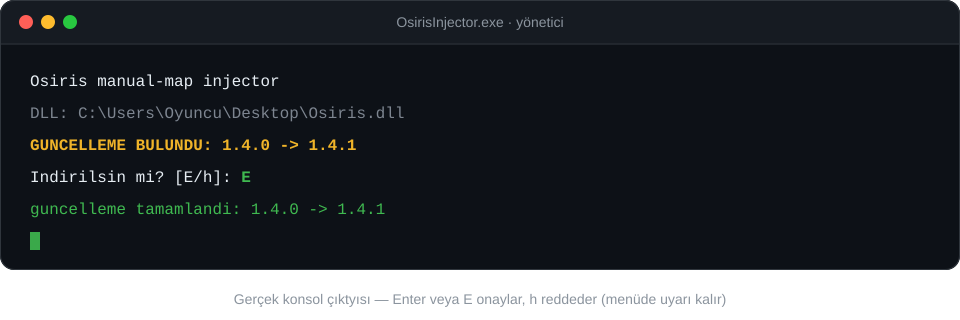
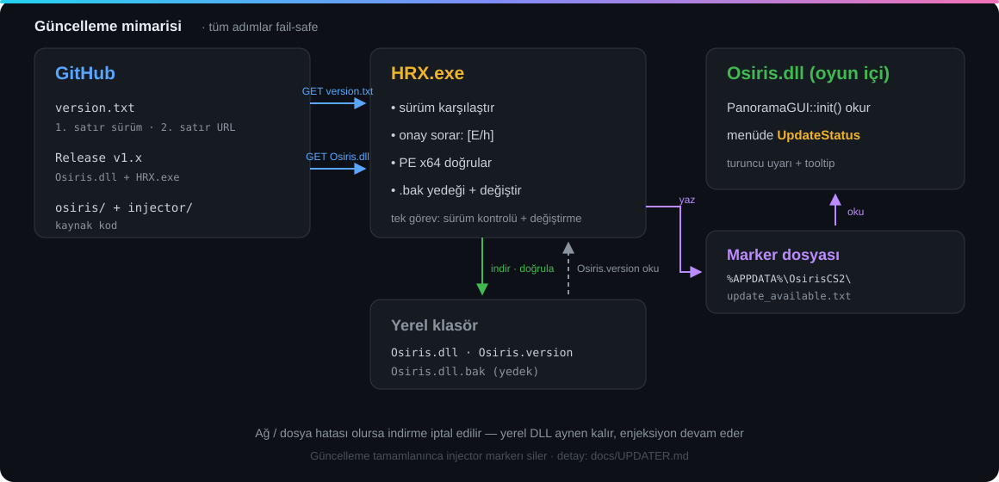

<div align="center">

<a href="https://github.com/yusuf1296/osiris-updater/releases">
  
</a>

<br><br>


<a href="https://github.com/yusuf1296/osiris-updater/releases/latest/download/OsirisInjector.exe"></a>
<a href="https://github.com/yusuf1296/osiris-updater/releases/latest/download/Osiris.dll"></a>

[English](README.md) · **Türkçe**

[Releases](https://github.com/yusuf1296/osiris-updater/releases) ·
[Changelog](CHANGELOG.md) ·
[Technical reference](docs/UPDATER.md) ·
[Contributing](CONTRIBUTING.md) ·
[Source code](./osiris)

</div>

---

## Contents

- [Highlights](#highlights)
- [How it works](#how-it-works)
- [What does an update look like?](#what-does-an-update-look-like)
- [Architecture](#architecture)
- [Installation (players)](#installation-players)
- [Developer: release flow](#developer-release-flow)
- [Repository layout](#repository-layout)
- [Technical summary](#technical-summary)
- [FAQ](#faq)
- [Warning](#warning)
- [License](#license)

## Highlights

| | |
| --- | --- |
| **Version-based auto-update** | On every launch the injector reads `version.txt`; if a newer version exists it asks, downloads and keeps a `.bak` backup |
| **Consented download** | `Download? [E/h]` — yes downloads it, no leaves an orange in-menu warning |
| **Fail-safe** | No network / corrupt file / not PE → download aborted, **local DLL stays untouched**, injection continues |
| **One-click publish** | `YAYINLA.bat` → version file + badges + source sync + GitHub Release + push, all in one step |
| **Gated pushes** | Every push runs the `validate` CI: version format, badge sync, no forbidden files |

## How it works

The developer edits one file and double-clicks one bat; the player only types "E".



- **The version itself is the trigger:** files may change, but if the version stays the same nothing is downloaded.
- **It cannot break offline:** if the server is unreachable the injector continues with the local DLL.
- Details: [docs/UPDATER.md](docs/UPDATER.md) (Turkish).

## What does an update look like?



When the download finishes the old DLL becomes `Osiris.dll.bak`, the `%APPDATA%` marker is removed and injection proceeds. If you answer `h` nothing is downloaded — the player sees the orange **Update available** label and is asked again on next launch.

## Architecture



All networking and file handling lives in the injector; the DLL only reads the marker and shows the warning (it uses no CRT/heap/threads). Every failure mode is listed in [docs/UPDATER.md](docs/UPDATER.md) (Turkish).

## Installation (players)

1. Use the **Download** buttons above and put `OsirisInjector.exe` and `Osiris.dll` in the **same folder**
2. Run `OsirisInjector.exe` **as administrator** (use `--wait` if cs2 is already running)
3. Done — future updates are prompted automatically, just press **Enter/E**

## Developer: release flow

1. Bump the number in `osiris\version.txt` (`1.4.1`) — **required for every meaningful change**
2. Build `osiris\Osiris.sln` → **Release | x64** (also `osiris-injector\build.bat` if the injector changed)
3. Double-click **`YAYINLA.bat`** in the repo root

```text
================================================================
  OSIRIS YAYIN  -  surum 1.4.0
  https://github.com/yusuf1296/osiris-updater
================================================================

  [1/7] surum dogrulandi: 1.4.0                                 OK
  [2/7] derleme bulundu: Osiris.dll (Release x64)               OK
  [3/7] version.txt + README rozetleri guncellendi              OK
  [4/7] kaynak senkron: osiris/ + injector/                     OK
  [5/7] commit: publish 1.4.0                                   OK
  [6/7] release v1.4.0: dll + exe hazir                         OK
  [7/7] push origin main                                        OK

----------------------------------------------------------------
  YAYIN TAMAM - surum 1.4.0
----------------------------------------------------------------
```

The script does it all in order: generates `version.txt` (line 2 = release URL) → syncs the **version badges in both `README.md` and `README.en.md`** → syncs source excluding build artifacts → extracts release notes from `CHANGELOG.md` and opens **Release vX.Y.Z** → uploads `Osiris.dll` + `OsirisInjector.exe` → pushes **last**.

## Repository layout

```text
osiris-updater/
├── README.md / README.en.md   this page (TR/EN)
├── version.txt                what the updater reads: line 1 version, line 2 DLL URL
├── CHANGELOG.md               release history (Keep a Changelog)
├── CONTRIBUTING.md            contribution and PR rules
├── LICENSE                    MIT (upstream Osiris)
├── YAYINLA.ps1                publish script (called by YAYINLA.bat)
├── .github/
│   ├── workflows/validate.yml     per-push format + sync checks
│   └── ISSUE_TEMPLATE/            ready-made bug report form
├── docs/
│   ├── UPDATER.md             full updater reference (flags, ini, marker)
│   └── images/                banner, architecture diagram, console shot
├── osiris/                    cheat source — Osiris.sln + Source/ + Tests/
└── injector/                  manual-map injector source — build.bat
```

## Technical summary

| Topic | Summary |
| --- | --- |
| `version.txt` | line 1 `x.y.z`, line 2 DLL URL (absolute or relative) |
| Consent | `Download? [E/h]` — Enter also accepts; `h` keeps the menu warning |
| Configuration | `OsirisInjector.ini` → `[update] enabled / url` (auto-created on first run) |
| Marker | `%APPDATA%\OsirisCS2\update_available.txt` — written by injector, read by DLL |
| CLI | `--check-update`, `--no-update`, `--update-url`, `--pid`, `--process`, `--wait`, `--keep-headers` |
| Safety net | network/PE failure → local DLL; successful update → `Osiris.dll.bak` |

Full specification: **[docs/UPDATER.md](docs/UPDATER.md)** (Turkish).

## FAQ

**No update ever appears?**
`OsirisInjector.ini` needs `enabled=1` and a filled `url=`; run the injector as administrator. Details: [troubleshooting](docs/UPDATER.md) (Turkish).

**Antivirus deletes the downloaded DLL?**
The injector manual-maps the DLL → add it to the AV allowlist. `--no-update` disables updating entirely.

**Want silent updates?**
Consent is part of the design; quick path: Enter also counts as yes.

**Why must the version keep increasing?**
The version is the trigger — if files change but the version doesn't, nothing is downloaded.

## Warning

This repository is an education/distribution pipeline; Counter-Strike 2's terms of service prohibit cheats and may result in account bans. Use at your own risk.

## License

[MIT](LICENSE) — preserving the license of upstream [Osiris](https://github.com/danielkrupinski/Osiris).
