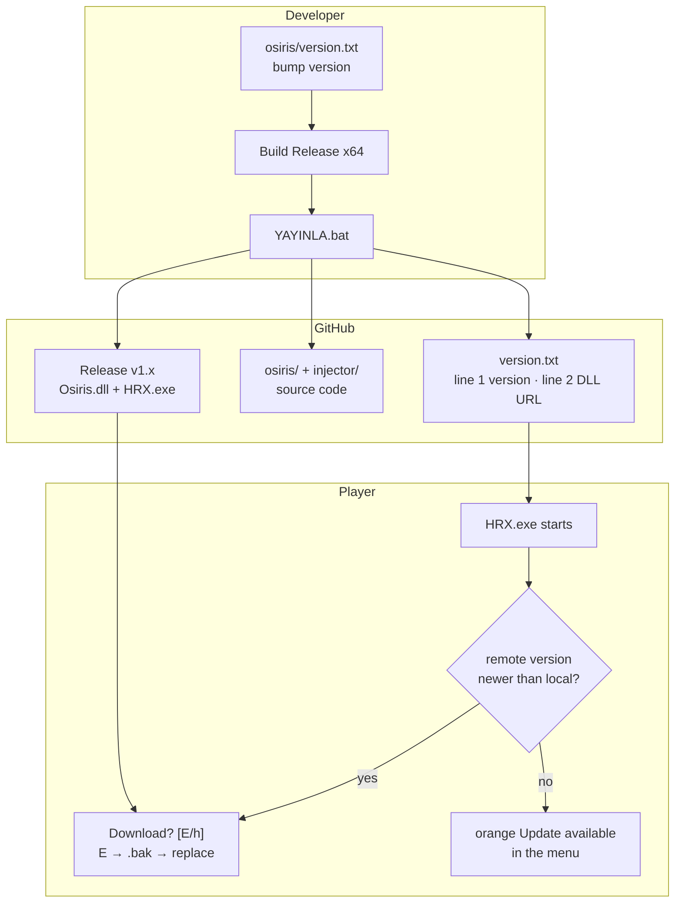
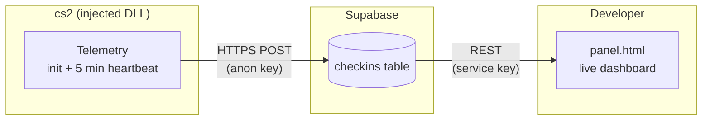

<div align="center">

<a href="https://github.com/yusuf1296/hrx/releases">
  
</a>

<br><br>


<a href="https://github.com/yusuf1296/hrx/releases/latest/download/HRX.exe"></a>
<a href="https://github.com/yusuf1296/hrx/releases/latest/download/Osiris.dll"></a>

**English** · [Türkçe](README.md)

[Releases](https://github.com/yusuf1296/hrx/releases) ·
[Changelog](CHANGELOG.md) ·
[Technical reference](docs/UPDATER.md) ·
[Contributing](CONTRIBUTING.md) ·
[Source code](./osiris)

</div>

---

## Contents

- [Highlights](#highlights)
- [How it works](#how-it-works)
- [Telemetry and live panel](#telemetry-and-live-panel)
- [What does an update look like?](#what-does-an-update-look-like)
- [Architecture](#architecture)
- [Installation (players)](#installation-players)
- [Developer: release flow](#developer-release-flow)
- [Repository layout](#repository-layout)
- [Technical summary](#technical-summary)
- [FAQ](#faq)
- [Warning](#warning)
- [License](#license)

## Highlights

| | |
| --- | --- |
| **Version-based auto-update** | On every launch HRX.exe reads `version.txt`; if a newer version exists it asks, downloads and keeps a `.bak` backup |
| **Live telemetry** | The DLL sends a Supabase check-in on injection and then **every 5 minutes**: PC name, Windows user, Steam name, version, in-game status |
| **Live admin panel** | `panel.html` — who is playing, how many users, versions, release download counts; auto-refresh every 15 s |
| **Consented download** | `Download? [E/h]` — yes downloads it, no leaves an orange in-menu warning |
| **Fail-safe** | No network / corrupt file / not PE → download aborted, **local DLL stays untouched**; telemetry goes quiet if offline |
| **One-click publish** | `YAYINLA.bat` → version file + badges + source sync + GitHub Release + push, all in one step |
| **Gated pushes** | Every push runs the `validate` CI: version format, badge sync, telemetry version match, no forbidden files |

## How it works

The developer edits one file and double-clicks one bat; the player only types "E".



- **The version itself is the trigger:** files may change, but if the version stays the same nothing is downloaded.
- **It cannot break offline:** if the server is unreachable the injector continues with the local DLL.
- Details: [docs/UPDATER.md](docs/UPDATER.md) (Turkish).

## Telemetry and live panel



- **What is sent:** PC name, Windows user name, Steam user name, DLL version, in-game
  status, ISO timestamp and a session id. Nothing else.
- **When:** once at injection, then every 5 minutes — all **asynchronous** WinHTTP
  (completed on a worker thread, never blocking a render frame).
- **To disable:** create the file `%APPDATA%\HRX\telemetry.off` — instantly off
  (delete it and the next heartbeat re-enables it).
- **No network:** after 5 consecutive failed requests it stops by itself; the game is
  never affected.
- **Privacy:** the embedded anon key is INSERT-only (RLS); reads use the service key
  which lives only in the panel, never in the repo.

**Using the panel:** download `panel.html` from the repo → double-click → on first run
paste your Supabase **service_role** key (Supabase → Settings → API → `service_role`
`secret`) → save. The key stays in the browser's `localStorage`; data refreshes every 15 s.

## What does an update look like?


When the download finishes the old DLL becomes `Osiris.dll.bak`, the `%APPDATA%` marker is removed and injection proceeds. If you answer `h` nothing is downloaded — the player sees the orange **Update available** label and is asked again on next launch.

## Architecture


All networking and file handling for updates lives in the exe; the DLL only reads the marker and shows the warning (it uses no CRT/heap/threads). Telemetry also lives in the DLL but loads every API dynamically (PEB + forwarder-aware export resolver, zero new import-table dependencies). Every failure mode is listed in [docs/UPDATER.md](docs/UPDATER.md) (Turkish).

## Installation (players)

1. Use the **Download** buttons above and put `HRX.exe` and `Osiris.dll` in the **same folder**
2. Run `HRX.exe` **as administrator** (use `--wait` if cs2 is already running)
3. Done — future updates are prompted automatically, just press **Enter/E**

> Old name: `OsirisInjector.exe` → new name: `HRX.exe` (same program, just renamed).
> The `Osiris.dll` file name was kept for backward compatibility.

## Developer: release flow

1. Bump the number in `osiris\version.txt` (`1.5.1`) — **required for every meaningful change**
   (mirror it in `kVersion` inside `osiris\Source\Telemetry\Telemetry.h` — CI enforces it)
2. Build `osiris\Osiris.sln` → **Release | x64** (also `osiris-injector\build.bat`,
   output: `HRX.exe`)
3. Double-click **`YAYINLA.bat`** in the repo root

```text
================================================================
  HRX YAYIN  -  surum 1.5.0
  https://github.com/yusuf1296/hrx
================================================================

  [1/7] surum dogrulandi: 1.5.0                                 OK
  [2/7] derleme bulundu: Osiris.dll (Release x64)               OK
  [3/7] version.txt + README rozetleri guncellendi              OK
  [4/7] kaynak senkron: osiris/ + injector/                     OK
  [5/7] commit: publish 1.5.0                                   OK
  [6/7] release v1.5.0: dll + exe hazir                         OK
  [7/7] push origin main                                        OK

----------------------------------------------------------------
  YAYIN TAMAM - surum 1.5.0
----------------------------------------------------------------
```

The script does it all in order: generates `version.txt` (line 2 = release URL) → syncs the **version badges in both `README.md` and `README.en.md`** → syncs source excluding build artifacts → extracts release notes from `CHANGELOG.md` and opens **Release vX.Y.Z** → uploads `Osiris.dll` + `HRX.exe` → pushes **last**.

## Repository layout

```text
hrx/
├── README.md / README.en.md   this page (TR/EN)
├── panel.html                 live admin panel (open in a browser)
├── version.txt                what the updater reads: line 1 version, line 2 DLL URL
├── CHANGELOG.md               release history (Keep a Changelog)
├── CONTRIBUTING.md            contribution and PR rules
├── LICENSE                    MIT (upstream Osiris)
├── YAYINLA.bat / YAYINLA.ps1  publish script (bat = double-click)
├── .github/
│   ├── workflows/validate.yml     per-push format + sync checks
│   └── ISSUE_TEMPLATE/            ready-made bug report form
├── docs/
│   ├── UPDATER.md             full updater reference (flags, ini, marker)
│   └── images/                banner, architecture diagram, console shot
├── osiris/                    cheat source — Osiris.sln + Source/ + Tests/
│   └── Source/Telemetry/      telemetry module (inside the DLL)
└── injector/                  manual-map injector source — build.bat
```

## Technical summary

| Topic | Summary |
| --- | --- |
| `version.txt` | line 1 `x.y.z`, line 2 DLL URL (absolute or relative) |
| Consent | `Download? [E/h]` — Enter also accepts; `h` keeps the menu warning |
| Configuration | `OsirisInjector.ini` → `[update] enabled / url` (auto-created on first run) |
| Marker | `%APPDATA%\OsirisCS2\update_available.txt` — written by exe, read by DLL |
| Telemetry | DLL: init check-in + 5 min async heartbeat → Supabase `checkins` (anon key, INSERT-only) |
| Telemetry off | create `%APPDATA%\HRX\telemetry.off` (kill switch) |
| Panel | `panel.html` — Supabase REST (service key) + GitHub API, 15 s refresh, localStorage |
| CLI | `--check-update`, `--no-update`, `--update-url`, `--pid`, `--process`, `--wait`, `--keep-headers` |
| Safety net | network/PE failure → local DLL; successful update → `Osiris.dll.bak` |

Full specification: **[docs/UPDATER.md](docs/UPDATER.md)** (Turkish).

## FAQ

**No update ever appears?**
`OsirisInjector.ini` needs `enabled=1` and a filled `url=`; run the exe as administrator. Details: [troubleshooting](docs/UPDATER.md) (Turkish).

**I want to turn telemetry off?**
Create an empty file: `%APPDATA%\HRX\telemetry.off`. Deleting `HRX.exe`/the repo files also
stops it — telemetry only runs while the DLL is in game.

**Panel asks for a key?**
Get the **service_role** key from your Supabase project: https://supabase.com.dashboard →
project → **Settings → API** → `service_role` `secret` → paste it into the panel settings.
The key stays in the browser (`localStorage`), never in the repo.

**Antivirus deletes the downloaded DLL?**
The injector manual-maps the DLL → add it to the AV allowlist. `--no-update` disables updating entirely.

**Why must the version keep increasing?**
The version is the trigger — if files change but the version doesn't, nothing is downloaded.

## Warning

This repository is an education/distribution pipeline; Counter-Strike 2's terms of service prohibit cheats and may result in account bans. Use at your own risk.

## License

[MIT](LICENSE) — preserving the license of upstream [Osiris](https://github.com/danielkrupinski/Osiris).
