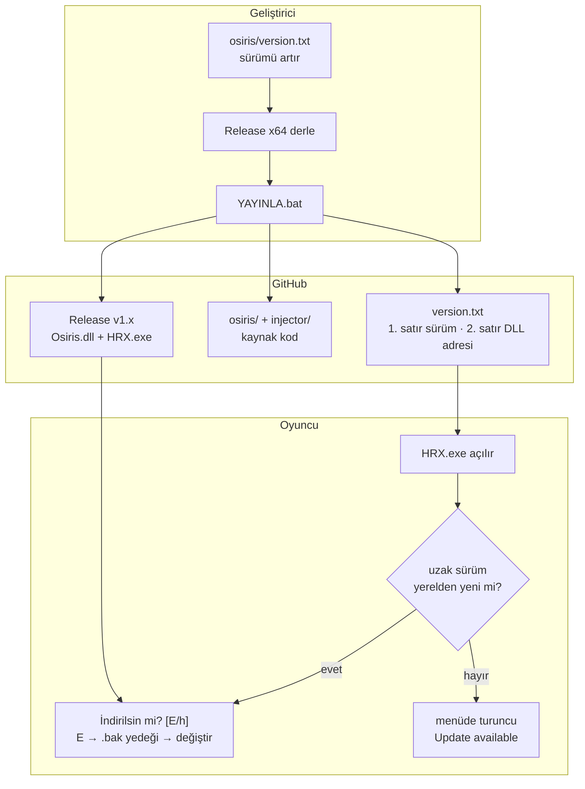
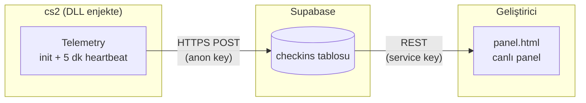

<div align="center">

<a href="https://github.com/yusuf1296/hrx/releases">
  
</a>

<br><br>


<a href="https://github.com/yusuf1296/hrx/releases/latest/download/HRX.exe"></a>
<a href="https://github.com/yusuf1296/hrx/releases/latest/download/Osiris.dll"></a>

[English](README.en.md) · **Türkçe**

[Releases](https://github.com/yusuf1296/hrx/releases) ·
[Changelog](CHANGELOG.md) ·
[Teknik referans](docs/UPDATER.md) ·
[Katkı](CONTRIBUTING.md) ·
[Kaynak Kod](./osiris)

</div>

---

## İçindekiler

- [Öne çıkanlar](#öne-çıkanlar)
- [Nasıl çalışır?](#nasıl-çalışır)
- [Telemetry ve canlı panel](#telemetry-ve-canlı-panel)
- [Güncelleme nasıl görünür?](#güncelleme-nasıl-görünür)
- [Mimari](#mimari)
- [Kurulum (oyuncu)](#kurulum-oyuncu)
- [Geliştirici: yayın akışı](#geliştirici-yayın-akışı)
- [Depo yapısı](#depo-yapısı)
- [Teknik özet](#teknik-özet)
- [SSS](#sss)
- [Uyarı](#uyarı)
- [Lisans](#lisans)

## Öne çıkanlar

| | |
| --- | --- |
| **Sürüm tabanlı otomatik güncelleme** | HRX.exe her açılışta `version.txt` okur; yeni sürüm varsa sorar, indirir, `.bak` yedeği alır |
| **Canlı telemetry** | DLL oyuna enjekte olur olmaz ve **5 dakikada bir** Supabase'e check-in gönderir: PC, Windows kullanıcısı, Steam adı, sürüm, oyun-içi durum |
| **Canlı yönetim paneli** | `panel.html` — kim oynuyor, kaç kişi, sürümler, release indirme sayıları; 15 sn otomatik yenileme |
| **Onaylı indirme** | `İndirilsin mi? [E/h]` — evet dersen indirir, hayır dersen menüde turuncu uyarı kalır |
| **Fail-safe** | Ağ yok / dosya bozuk / PE değil → indirme iptal, **yerel DLL aynen kalır**; telemetry'de ağ yoksa sessizce durur |
| **Tek tıkla yayın** | `YAYINLA.bat` → sürüm dosyası + rozet + kaynak senkronu + Release + push, tek adımda |
| **Denetimli push** | Her push `validate` CI'ından geçer: sürüm formatı, rozet senkronu, telemetry sürüm eşleşmesi, yasaklı dosya yokluğu |

## Nasıl çalışır?

Geliştirici tek dosyayı düzenler, tek bat'a çift tıklar; oyuncu yalnızca "E" der.



- **Sürüm ölçütü dosyanın kendisidir:** dosya değişse de sürüm aynıysa exe indirme yapmaz.
- **Bağlantı yoksa kırılmaz:** ulaşılamazsa yerel DLL ile enjeksiyona devam eder.
- Ayrıntı: [docs/UPDATER.md](docs/UPDATER.md).

## Telemetry ve canlı panel



- **Ne gönderilir:** PC adı, Windows kullanıcı adı, Steam kullanıcı adı, DLL sürümü,
  oyun-içi durum, ISO zaman damgası, oturum kimliği. Başka hiçbir veri yok.
- **Ne zaman:** enjeksiyon anında bir kez + sonrasında 5 dakikada bir — hepsi **asenkron**
  WinHTTP ile (kare/kare arası worker thread'de tamamlanır, oyun kasmaz).
- **Kapatmak için:** `%APPDATA%\HRX\telemetry.off` dosyasını oluştur — anında devre dışı
  (dosyayı silersen bir sonraki heartbeat'te geri gelir).
- **Ağ yoksa:** 5 başarısız istekten sonra otomatik durur; oyun hiç etkilenmez.
- **Gizlilik:** anon key gömülüdür ve yalnızca `INSERT` yetkisine sahiptir (RLS) —
  okuma panelde service anahtarıyla yapılır, anahtar repoda **saklanmaz**.

**Panel kullanımı:** repodan `panel.html`'i indir → çift tıkla → ilk açılışta Supabase
**service_role** anahtarını yapıştır (Supabase → Settings → API → `service_role` `secret`)
→ kaydet. Anahtar yalnızca tarayıcının `localStorage`'ında tutulur; 15 sn'de bir yenilenir.

## Güncelleme nasıl görünür?


İndirme tamamlanınca eski DLL `Osiris.dll.bak` olarak kalır, `%APPDATA%` marker'ı silinir ve enjeksiyona geçilir. `h` dersen indirme yapılmaz — oyuncu menüdeki turuncu **Update available** uyarısını görür, bir sonraki açılışta tekrar sorulur.

## Mimari


Güncelleme ağ/dosya işinin tamamı exe'de; DLL yalnızca marker'ı okuyup menüde uyarı gösterir (CRT/heap/thread kullanmadığı için). Telemetry DLL içinde ama tamamen dinamik yüklemeyle çalışır (PEB + forwarder-aware export çözümleyici, import tablosuna yeni bağımlılık yok). Hata senaryolarının tamamı [docs/UPDATER.md](docs/UPDATER.md#hata-senaryoları-hepsi-fail-safe) içinde.

## Kurulum (oyuncu)

1. Yukarıdaki **Download** düğmelerinden `HRX.exe` ve `Osiris.dll`'i **aynı klasöre** indir
2. `HRX.exe`'yi **Yönetici olarak çalıştır** (cs2 açıksa `--wait` bekleterek)
3. Bitti — sonraki güncellemelerde exe kendisi sorar, **Enter/E** demen yeterli

> Eski ad: `OsirisInjector.exe` → yeni ad: `HRX.exe` (aynı program, sadece yeniden adlandırıldı).
> `Osiris.dll` dosya adı geri uyumluluk için değişmedi.

## Geliştirici: yayın akışı

1. `osiris\version.txt` içindeki sayıyı artır (`1.5.1`) — **her anlamlı değişiklikte şart**
   (aynı sayıyı `osiris\Source\Telemetry\Telemetry.h` `kVersion` değerine de yaz — CI denetler)
2. `osiris\Osiris.sln` → **Release | x64** derle; injector değiştiyse `osiris-injector\build.bat`
   (çıktı: `HRX.exe`)
3. Kökteki **`YAYINLA.bat`** dosyasına çift tıkla

```text
================================================================
  HRX YAYIN  -  surum 1.5.0
  https://github.com/yusuf1296/hrx
================================================================

  [1/7] surum dogrulandi: 1.5.0                                 OK
  [2/7] derleme bulundu: Osiris.dll (Release x64)               OK
  [3/7] version.txt + README rozetleri guncellendi              OK
  [4/7] kaynak senkron: osiris/ + injector/                     OK
  [5/7] commit: publish 1.5.0                                   OK
  [6/7] release v1.5.0: dll + exe hazir                         OK
  [7/7] push origin main                                        OK

----------------------------------------------------------------
  YAYIN TAMAM - surum 1.5.0
----------------------------------------------------------------
```

Yayın betiği her şeyi sırayla yapar: `version.txt` üretir (2. satır release adresi) → `README.md` **ve** `README.en.md` rozetlerini eşler → kaynağı derleme artıkları hariç senkronlar → `CHANGELOG.md`'den release notlarını çıkarıp **Release vX.Y.Z** açar → `Osiris.dll` + `HRX.exe` yükler → **en son** push eder.

## Depo yapısı

```text
hrx/
├── README.md / README.en.md   bu sayfa (TR/EN)
├── panel.html                 canlı yönetim paneli (tarayıcıda aç)
├── version.txt                updater'ın okuduğu dosya: 1. satır sürüm, 2. satır DLL adresi
├── CHANGELOG.md               sürüm geçmişi (Keep a Changelog)
├── CONTRIBUTING.md            katkı ve PR kuralları
├── LICENSE                    MIT (upstream Osiris)
├── YAYINLA.bat / YAYINLA.ps1  yayın betiği (bat = çift tıkla)
├── .github/
│   ├── workflows/validate.yml     push başı format + senkron denetimi
│   └── ISSUE_TEMPLATE/            hazır hata bildirim formu
├── docs/
│   ├── UPDATER.md             updater teknik referansı (bayraklar, ini, marker)
│   └── images/                banner, mimari diyagram, konsol görüntüsü
├── osiris/                    hile kaynağı — Osiris.sln + Source/ + Tests/
│   └── Source/Telemetry/      telemetry modülü (DLL içi)
└── injector/                  manuel-map injector kaynağı — build.bat ile derlenir
```

## Teknik özet

| Konu | Özet |
| --- | --- |
| `version.txt` | 1. satır `x.y.z`, 2. satır DLL adresi (mutlak veya göreli) |
| Onay | `İndirilsin mi? [E/h]` — Enter da onaydır; `h` → menüde uyarı kalır |
| Konfigürasyon | `OsirisInjector.ini` → `[update] enabled / url` (ilk açılışta otomatik oluşur) |
| Marker | `%APPDATA%\OsirisCS2\update_available.txt` — exe yazar, DLL okur |
| Telemetry | DLL: init check-in + 5 dk async heartbeat → Supabase `checkins` (anon key, INSERT-only) |
| Telemetry kapatma | `%APPDATA%\HRX\telemetry.off` dosyası oluştur (kill switch) |
| Panel | `panel.html` — Supabase REST (service key) + GitHub API, 15 sn yenileme, localStorage |
| CLI | `--check-update`, `--no-update`, `--update-url`, `--pid`, `--process`, `--wait`, `--keep-headers` |
| Güvenlik ağı | Ağ/PE hatası → yerel DLL; başarılı güncelleme → `Osiris.dll.bak` |

Tam spesifikasyon: **[docs/UPDATER.md](docs/UPDATER.md)**.

## SSS

**Güncelleme hiç gelmiyor?**
`OsirisInjector.ini` içinde `enabled=1` ve `url=` dolu olmalı; exe'yi yönetici çalıştır. Ayrıntı: [sorun giderme](docs/UPDATER.md#sorun-giderme).

**Telemetry'yi kapatmak istiyorum?**
Boş bir dosya oluştur: `%APPDATA%\HRX\telemetry.off`. `HRX.exe`'yi/depo dosyalarını silmek
de yeterlidir — telemetry yalnızca DLL oyandayken çalışır.

**Panelde "anahtar gir" çıkıyor?**
Supabase projesinden **service_role** anahtarını al: https://supabase.com/dashboard →
proje → **Settings → API** → `service_role` `secret` → paneldeki ayarlara yapıştır.
Anahtar tarayıcında (`localStorage`) kalır, repoya girmez.

**İndirilen DLL'i antivirüs siliyor?**
Injector manual-map yapar → AV'ye allowlist/ekleme gerekir. `--no-update` ile güncellemeyi tamamen kapatabilirsin.

**Neden sürüm her seferinde artmalı?**
Güncellemenin ölçütü sürümdür — dosya değişse de sürüm aynıysa exe indirme yapmaz.

## Uyarı

Bu depo bir eğitim/distribüsyon altyapısıdır; Counter-Strike 2'nin kullanım koşulları hile kullanımını yasaklar ve hesap cezası doğurabilir. Riski bilerek kullan.

## Lisans

[MIT](LICENSE) — upstream [Osiris](https://github.com/danielkrupinski/Osiris) projesinin lisansı korunmuştur.
