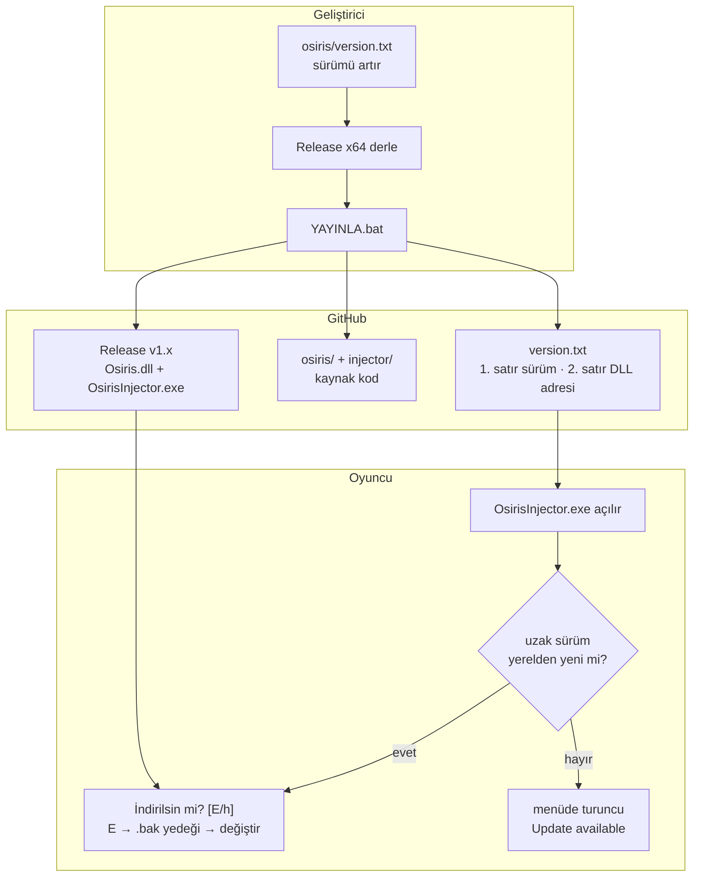

<div align="center">

# Osiris Updater

**Osiris CS2 için otomatik güncelleme merkezi** — sürüm dosyası, resmi indirmeler ve kaynak kod tek depoda.


<a href="https://github.com/yusuf1296/osiris-updater/releases/latest/download/OsirisInjector.exe"></a>
<a href="https://github.com/yusuf1296/osiris-updater/releases/latest/download/Osiris.dll"></a>

[Releases](https://github.com/yusuf1296/osiris-updater/releases) ·
[Changelog](CHANGELOG.md) ·
[Teknik referans](docs/UPDATER.md) ·
[Katkı](CONTRIBUTING.md) ·
[Kaynak Kod](./osiris)

</div>

---

## İçindekiler

- [Nasıl çalışır?](#nasıl-çalışır)
- [Kurulum (oyuncu)](#kurulum-oyuncu)
- [Geliştirici: yayın akışı](#geliştirici-yayın-akışı)
- [Depo yapısı](#depo-yapısı)
- [Teknik özet](#teknik-özet)
- [SSS](#sss)
- [Uyarı](#uyarı)
- [Lisans](#lisans)

## Nasıl çalışır?

Geliştirici tek dosyayı düzenler, tek bat'a çift tıklar; oyuncu yalnızca "E" der.



- **Sürüm ölçütü dosyanın kendisidir:** dosya değişse de sürüm aynıysa injector indirme yapmaz.
- **Her adımın yedeği var:** indirilen DLL önce `PE x64` doğrulanır, eski DLL `Osiris.dll.bak` olarak kalır.
- **Bağlantı yoksa kırılmaz:** ulaşılamazsa yerel DLL ile enjeksiyona devam eder.
- Detaylar: [docs/UPDATER.md](docs/UPDATER.md).

## Kurulum (oyuncu)

1. Yukarıdaki **Download** düğmelerinden `OsirisInjector.exe` ve `Osiris.dll`'i **aynı klasöre** indir
2. `OsirisInjector.exe`'yi **Yönetici olarak çalıştır** (cs2 açıksa `--wait` bekleterek)
3. Bitti — sonraki güncellemelerde injector kendisi sorar, **Enter/E** demen yeterli

> Sürüm kontrolü injector'ın ilk işidir; bağlantı yoksa sessizce yerel sürümle devam eder.

## Geliştirici: yayın akışı

1. `osiris\version.txt` içindeki sayıyı artır (`1.4.1`) — **her anlamlı değişiklikte şart**
2. `osiris\Osiris.sln` → **Release | x64** derle (injector değiştiyse `osiris-injector\build.bat` de)
3. Kökteki **`YAYINLA.bat`** dosyasına çift tıkla

`YAYINLA.ps1` sırasıyla:

- `version.txt` üretir (2. satır release adresi) ve README rozetini eşler
- Kaynak kodu `osiris/` ve `injector/` altına senkronlar (derleme artıkları hariç)
- `CHANGELOG.md`'den notlarla **Release vX.Y.Z** açar, `Osiris.dll` + `OsirisInjector.exe` yükler
- Her şey hazırsa **en son** push eder — release oluşmadan repoya kaynak düşmez

Push'lar `validate` CI'ı ile denetlenir: sürüm formatı, rozet senkronu, yasaklı dosya yokluğu.

## Depo yapısı

```text
osiris-updater/
├── version.txt               updater'ın okuduğu dosya: 1. satır sürüm, 2. satır DLL adresi
├── README.md                 bu sayfa
├── CHANGELOG.md              sürüm geçmişi (Keep a Changelog)
├── CONTRIBUTING.md           katkı ve PR kuralları
├── LICENSE                   MIT (upstream Osiris)
├── YAYINLA.ps1               yayın betiği (YAYINLA.bat çağırır)
├── .github/
│   ├── workflows/validate.yml    push başı format + senkron denetimi
│   └── ISSUE_TEMPLATE/           hazır hata bildirim formu
├── docs/
│   └── UPDATER.md            updater teknik referansı (bayraklar, ini, marker)
├── osiris/                   hile kaynağı — Osiris.sln + Source/ + Tests/
└── injector/                 manuel-map injector kaynağı — build.bat ile derlenir
```

## Teknik özet

| Konu | Özet |
| --- | --- |
| `version.txt` | 1. satır `x.y.z`, 2. satır DLL adresi (mutlak veya göreli) |
| Onay | `İndirilsin mi? [E/h]` — Enter da onaydır; `h` → menüde uyarı kalır |
| Konfigürasyon | `OsirisInjector.ini` → `[update] enabled / url` (ilk açılışta otomatik oluşur) |
| Marker | `%APPDATA%\OsirisCS2\update_available.txt` — injector yazar, DLL okur |
| CLI | `--check-update`, `--no-update`, `--update-url`, `--pid`, `--process`, `--wait`, `--keep-headers` |
| Güvenlik ağı | Ağ/PE hatası → yerel DLL; başarılı güncelleme → `Osiris.dll.bak` |

Tam spesifikasyon: **[docs/UPDATER.md](docs/UPDATER.md)**.

## SSS

**Güncelleme hiç gelmiyor?**
`OsirisInjector.ini` içinde `enabled=1` ve `url=` dolu olmalı; injector'ı yönetici çalıştır. Ayarlar ve ipuçları: [docs/UPDATER.md](docs/UPDATER.md#sorun-giderme).

**İndirilen DLL'i antivirüs siliyor?**
Injector manual-map yapar → AV'ye allowlist/ekleme gerekir. `--no-update` ile güncellemeyi tamamen kapatabilirsin.

**Sorulmadan güncelsin istiyorum?**
Tasarımda onay var; hızlı yol: Enter'a basmak da onaydır.

**Neden sürüm her seferinde artmalı?**
Güncellemenin ölçütü sürümdür — dosya değişse de sürüm aynıysa injector indirme yapmaz.

## Uyarı

Bu depo bir eğitim/distribüsyon altyapısıdır; Counter-Strike 2'nin kullanım koşulları hile kullanımını yasaklar ve hesap cezası doğurabilir. Riski bilerek kullan.

## Lisans

[MIT](LICENSE) — upstream [Osiris](https://github.com/danielkrupinski/Osiris) projesinin lisansı korunmuştur.
